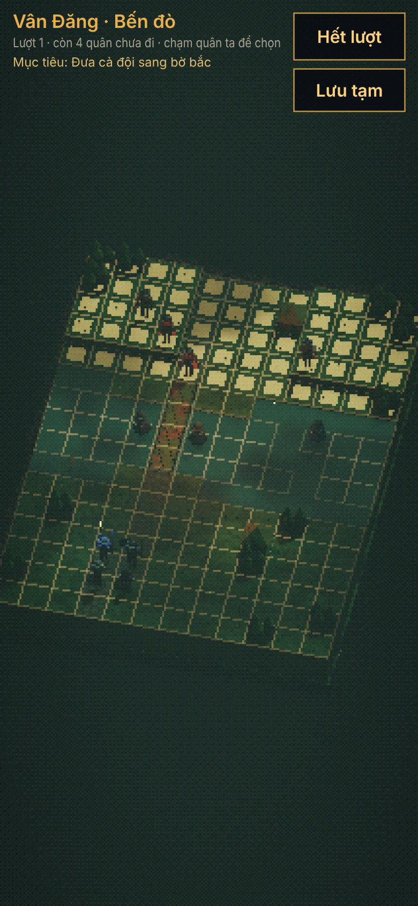
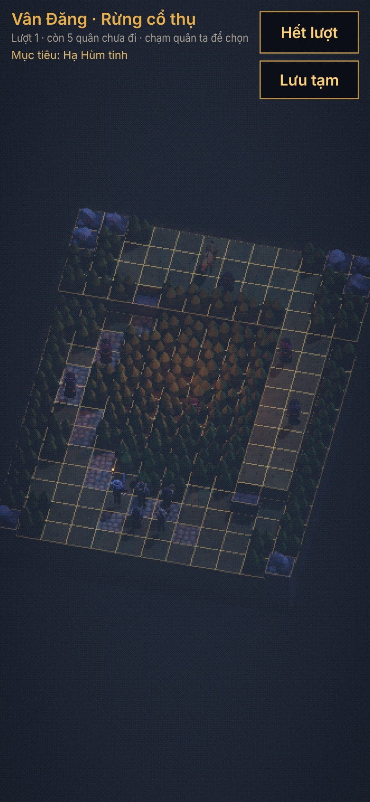
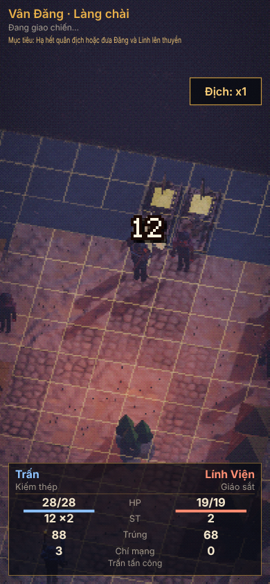

# Vân Đăng

Nhập vai chiến thuật theo lượt, 3D isometric, chạy trong **một file HTML**, ưu tiên điện thoại màn hình dọc. Khung luật Fire Emblem GBA, thế giới dân gian Việt. Tài liệu thiết kế: `GDD_Van_Dang.md` (trong Project).

Nền kỹ thuật fork từ [Cinderwatch](https://github.com/kevintngo/cinderwatch) (MIT) của Kevin Ngo; three.js r170 (MIT).


## Trạng thái: Tuần 6 (GSAP Timeline cho di chuyển + trận đánh, tua lượt địch); tuần 5 xong

- Đã gỡ logic tower defense (`60-towers`, `61-monsters`, `62-game`).
- Dữ liệu dạng JSON trong `data/`, được nhúng vào bản build.
- Logic lõi `src/34-core.js` tách khỏi phần vẽ, có test chạy bằng Node.
- Map thử 12×16 hiển thị bằng đồ họa Cinderwatch: địa hình, độ cao, tháp đèn, miếu, cầu, quân ta/địch/NPC, rương. Chạm/nhấn một ô để xem thông số.
- Tuần 2: tìm đường (`Core.reachable/pathTo/canStopAt`); chạm quân ta để tô vùng đi, chạm ô đích để xem đường, chạm lần nữa để đi; chạm ngoài vùng để hủy. Đi xong chọn **Chờ** hoặc **Hoàn tác**; nút **Hết lượt**; vòng lượt Ta → Địch → NPC (máy tạm thời chỉ tiến về quân ta gần nhất). Bàn phím: mũi tên + Enter, Esc hủy/hoàn tác, E hết lượt.
- Tuần 3: công thức chiến đấu `src/36-combat.js` (`Core.forecast`, `Core.fight`; 2RN, khắc chế, độ bền, hạng vũ khí). Đi xong, nếu có địch trong tầm vũ khí đang cầm thì menu có **Đánh** → ô đỏ là tầm đánh, chạm một địch để xem **bảng dự báo** (2 cột ta/địch: vũ khí, HP, ST ×2 khi đánh đôi, Trúng, Chí mạng, Độ bền nếu có; khắc chế ghi tên luật màu cam; bên không phản đòn được hiện "–"). Chạm lại mục tiêu hoặc nút **Đánh** để xác nhận → phát lại nhật ký đòn (số bay lên, HP tụt dần, Trượt / Chí mạng), quân về 0 HP rút lui (Casual). Đăng/Linh ngã → Thua trận. Đổi vũ khí tự do (GDD 2.5): mục tiêu tính theo mọi vũ khí dùng được trong túi; thanh **◀ ▶** trên bảng dự báo đổi giữa các món với tới mục tiêu; xác nhận thì món đó thành món đang cầm (lên đầu túi) và quyết định phản đòn lượt địch. Bàn phím: X = Đánh, Tab = đổi mục tiêu, ←/→ = đổi vũ khí, Enter = xác nhận, Esc = quay lại.
- Tuần 3: khung kỹ năng (logic thuần, chưa có UI) `src/37-skills.js` + `data/skills.json` (GDD 2.6): `Core.skillTargets`, `Core.useSkill`, `Core.skillForecast`, `Core.canAfford`, `Core.refillResources`, `Core.validateSkills`. Tài nguyên riêng mỗi trận (Dầu đèn, Nhịp đàn, Linh lực, Niệm lực), hồi đầy đầu trận; tầm ≤ `rangeCap` (4 ≈ 1/3 cạnh map). Đăng có Soi · Trấn · Hỏa · Hộ (6 Dầu đèn). Kỹ năng sát thương dùng công thức + khắc chế của `36-combat.js` (1 đòn, không phản đòn, không đánh đôi); trạng thái/môi trường mới ghi nhận vào kết quả, làm thật ở tuần 8.
- Tuần 5: lưu game `src/39-save.js` + `data/campaign.json` (GDD 5.4, 2.9, 9). Trạng thái chiến dịch JSON có số phiên bản (chương, chế độ Casual/Classic, đội: cấp/EXP/chỉ số/hạng/túi đồ/ai đã chết, đồ lấy được, rương giữ được → số đèn lồng). Lưu tự động sau mỗi chương + 1 ô **Lưu tạm** giữa trận (gồm trạng thái RNG, nạp lại chơi tiếp ra đúng kết quả cũ). Màn chính: Tiếp tục / Chơi mới · Casual / Chơi mới · Classic; bản lưu hỏng hoặc khác phiên bản thì báo, không vỡ game. Thắng tạm thời = hạ hết địch. `#map=…` vẫn chạy map thử như cũ (không lưu).
- Tuần 5 mục 3: đủ class + nhân vật + quái cho Ch.1–3 (GDD 7, 8). Class mới: Hát Rong (Cuội), Cung Thủ (Hùng Nỏ, lính Viện cung), Ma Nước, Ma Trành, Yêu Thú, Bóng Đè; mỗi class ghi `weaponTypes` (loại vũ khí cầm được). Phe ta thêm **Cuội** (Nhịp đàn 4: Hát Xẩm · Nói Phét · Vè Khích — dữ liệu, hiệu ứng chạy ở tuần 8) và **Hùng Nỏ** (Nỏ tay, khắc Bay). Địch: lính Viện kiếm/giáo/cung, Ma da (Ma, Thủy, chỉ đi nước), Ma trành, Hùm tinh (boss nhỏ, Yêu), Ma đè (Ma, Âm khí đánh vào Kháng); hành vi AI mặc định khai báo trong mẫu. Vũ khí bẩm sinh của quái: loại `vuot` (Nanh vuốt) và `am_khi` (Âm khí). Cơ chế riêng của quái (Ma da kéo/ẩn nước, trành tiếp sức Hùm tinh, Ma đè gây Ngủ) ghi ở `units.json → traits` / `traitTypes` (live: false, tuần 8). **Cung/nỏ đứng cao hơn mục tiêu +1 tầm** (GDD 3.2; `weapons.json → types.highGround`, `Core.rangeBonus`), áp cả khi phản đòn, cho bảng dự báo, menu Đánh và AI. Phần vẽ đọc `look.rig` (người: foot/ogre/…; quái: wraith/wolf/…) và các cờ bộ phận (`units.json → _look`).
- Tuần 5 mục 4: **khung chương + Ch.1 Làng Chài Cháy**. Danh sách chương chuyển sang `data/chapters.json` (thay `campaign.json`): map, ghi đè lớp quân/roster (dùng lại map), gia nhập, điều kiện thắng/thua, luật chương (`noSkills`, `noStatus`, `fog`, `deadZone`), hội thoại mở/kết, gợi ý hướng dẫn. Điều kiện chung `Core.outcome` (34-core): hạ hết địch · tới ô đích (mặc định = `exits`) · hạ boss · cả đội tới vùng · giữ sống N lượt; thua: Đăng/Linh ngã · quá N lượt · quân cần bảo vệ ngã. Luồng: màn chính → **màn chương** (mục tiêu, luật, gia nhập, hội thoại) → trận (dòng mục tiêu, gợi ý hướng dẫn 2 lượt đầu, ô đích tô vàng) → **kết quả** (lý do, số lượt, quân ngã, đã lưu, hội thoại kết) → Chương sau. Map A `lang_chai` (biển phía Bắc, bến + 2 thuyền = ô đích, nhà tranh từ ô `#` qua `decor`). `noSkills` chặn kỹ năng ở cả AI và `Core.useSkill`.

- Tuần 5 mục 5: **Ch.2 Bến Đò Sương + Ch.3 Rừng Trành**. Map B `ben_do` (sông nước sâu chia đôi, 1 cầu hẹp cột 4 + bãi nước nông quanh co cột 8–9; bờ bắc có hai gò cao 1 bậc cho cung). Ch.2: Cuội gia nhập, mở kỹ năng, thắng = cả đội vào bờ bắc (`area` dòng 0–4); địch: 2 cung giữ gò (bán kính 2), giáo chặn đầu cầu (bán kính 1), kiếm hộ vệ cung, 3 Ma da dưới nước kề lối qua (chỉ phản ứng khi vào tầm). Map C `rung_co_thu` (hang Hùm tinh trên cao 2 bậc, lên bằng 2 dốc: lối mòn hẹp phía Tây và sườn cao phía Đông; giữa là rừng dày). Ch.3: Hùng Nỏ gia nhập, cờ trạng thái mở, thắng = hạ Hùm tinh; địch: Hùm tinh giữ hang (bán kính 2), 4 Ma trành chặn hai lối (bán kính 1), 2 Ma đè (1 phục trong rừng, 1 hộ vệ Hùm tinh). **Chờ tuần 8:** Ma da kéo, Hát Xẩm thêm lượt, Ngủ, trành tiếp sức Hùm tinh (chương vẫn chơi trọn). AI thêm hành vi **Tới đích** (`toi_dich`) cho phe ta khi AI vs AI: không có nước đánh tốt thì tiến về vùng đích; Đăng/Linh chỉ nhích qua ô không nguy hiểm hơn ô đang đứng.

 

- Tuần 6 mục 1: **GSAP 3.15.1 (lõi)** cho hoạt ảnh hiển thị (`vendor/gsap.min.js`, `build.py` chèn như three.js; giấy phép ở `vendor/LICENSE-gsap.txt`). `src/54-anim.js` dựng **Timeline** cho di chuyển đơn vị và chuỗi trận đánh (lao tới + vung → trúng: giật lùi, chớp, HP tụt / trượt: né sang bên → số sát thương bay lên → lùi về; phản đòn, đánh đôi là các đòn tiếp theo trong nhật ký `Core.fight`; rút lui; +EXP). Timeline luôn paused và được tua tới đúng đồng hồ của Play (`P.anim.t`, `P.battle.t`, tăng bằng dt của vòng lặp game) → phát lại theo seed và `record.js` khớp từng khung. Logic (`34`–`39`) không dùng GSAP. **Tua lượt địch**: nút "Địch: x1" góc trên phải (hoặc phím T) xoay x1 → x2 → x4 → Bỏ qua; chỉ nhân dt cho lượt Địch/NPC, kết quả trận giống hệt ở mọi tốc độ; bảng Lên cấp không bị tua; tốc độ được nhớ (localStorage, trừ `#manual`).



## Chạy, build, test

```bash
python3 tools/build.py      # nối data/*.json + src/*.js + three.js + GSAP -> index.html
node tools/test_core.js     # test logic lõi, không cần trình duyệt
node tools/test_combat.js   # test công thức chiến đấu (2RN, dự báo, trận đấu)
node tools/test_skills.js   # test khung kỹ năng (mục tiêu, tài nguyên, sát thương kỹ năng)
node tools/test_ai.js       # test AI chấm điểm + AI vs AI
node tools/test_level.js    # test bảng class, EXP, lên cấp, hạng vũ khí
node tools/test_save.js     # test lưu game (chiến dịch, lưu chương, lưu tạm + RNG, bản lưu hỏng)
node tools/test_data.js     # test dữ liệu class/nhân vật/quái Ch.1–3, cơ chế quái (tuần 8), cung/nỏ đứng cao +1 tầm
node tools/test_anim.js     # test hoạt ảnh GSAP (Timeline đi/trận khớp nhật ký, tất định theo đồng hồ game) + tua lượt địch x1/x2/x4/bỏ qua ra cùng kết quả
node tools/test_chapter.js  # test chapters.json, điều kiện thắng/thua, luật chương, luồng chương, Ch.1–3; AI vs AI 100 trận mỗi chương
```

Mở `index.html` (chạy được từ `file://`). Cờ URL: `#map=thu`, `#ch=ch1` (chạy thẳng một chương từ màn chương, bản lưu tạm trong bộ nhớ, không đụng bản lưu thật; thêm `&skip=1` để bỏ màn chương), `#biome=fen`, `#sel=4,5` (chọn sẵn ô), `#seed=N`, `#fps=1`, `#manual=1`.

Chụp màn hình không giao diện (cần Chrome, Node ≥ 22):

```bash
CHROME=/usr/bin/google-chrome MOBILE=1 DPR=2 node tools/cdp.js "sel=1,13" 390,844 wait:5000 shot:phone
CHROME=/usr/bin/google-chrome node tools/cdp.js "" 390,844 "tapat:__vd.screenOfTile(7,12).join(',')" "eval:JSON.stringify(__vd.G.sel)"
```

## Cấu trúc

| Đường dẫn | Nội dung |
| --- | --- |
| `data/terrain.json` | Bảng địa hình (GDD 3.1): chi phí đi theo loại quân, Né, Thủ |
| `data/units.json` | Mẫu đơn vị: class + chỉ số cá nhân, nhãn, loại di chuyển, túi vũ khí, kỹ năng, hành vi AI, cơ chế quái (`traits`), `look` cho phần vẽ |
| `data/classes.json` | Bảng class (GDD 5.2): chỉ số gốc, growth, loại vũ khí cầm được |
| `data/weapons.json` | Vũ khí, loại vũ khí, khắc chế (GDD 2.4–2.5), `highGround` cho cung/nỏ |
| `data/skills.json` | Kỹ năng chủ động (GDD 2.6): tài nguyên, giá, tầm, loại mục tiêu, hiệu ứng dạng dữ liệu |
| `data/chapters.json` | Chương theo thứ tự: map (+ ghi đè lớp quân/roster), gia nhập, thắng/thua, luật, hội thoại, gợi ý hướng dẫn |
| `data/maps/*.json` | Map: 3 lớp ASCII + roster (+ `exits`, `decor`) |
| `src/00-util` … `29-biome`, `40-fx`, `41-weather`, `50-rig`, `51-bestiary`, `70-pixelfont`, `80-audio` | Module nền giữ từ Cinderwatch |
| `src/11-shared.js` | Phần dùng chung tách từ Cinderwatch: vật liệu, `Soup.seg`, `clothPanel`, thư viện đồ vật `PROP` |
| `src/34-core.js` | **Logic lõi** (thuần dữ liệu): đọc/kiểm tra map, tạo đơn vị, tra ô, chi phí di chuyển, RNG có seed |
| `src/35-board.js` | Vẽ bàn cờ ô vuông từ trạng thái map |
| `src/36-combat.js` | **Công thức chiến đấu** (thuần dữ liệu): `Core.forecast` (không đổi trạng thái), `Core.fight` (ghi HP, trả nhật ký đòn) |
| `src/36-play.js` | **Điều khiển lượt** (thuần dữ liệu): chọn quân → ô đích → đi → Đánh/Chờ/Hoàn tác, chọn mục tiêu → dự báo → xác nhận → phát lại (`battleView`); vòng lượt Ta → Địch → NPC, nước đi tạm cho quân máy |
| `src/37-skills.js` | **Khung kỹ năng** (thuần dữ liệu): mục tiêu, tài nguyên, `Core.useSkill` (sát thương thật, trạng thái/môi trường ghi nhận) |
| `src/56-overlay.js` | Tô vùng đi được (xanh = dừng được, tím = chỉ đi qua), vẽ đường đi; tô tầm đánh và mục tiêu (đỏ) |
| `src/54-anim.js` | Hoạt ảnh hiển thị bằng GSAP Timeline (đi, chuỗi trận đánh), tua theo đồng hồ của Play; không ghi vào logic |
| `src/55-units.js` | Vẽ đơn vị bằng rig người của Cinderwatch (tạm); tư thế đi/đánh đọc từ `54-anim` |
| `src/72-hud.js` | HUD (font hệ thống, có dấu tiếng Việt; số sát thương dùng `70-pixelfont`): menu, bảng dự báo, bảng phát lại trận |
| `src/90-main.js` | Camera (giữ từ Cinderwatch), nhập liệu, vòng lặp, khởi động |
| `legacy/` | File Cinderwatch không build nữa, giữ để tham khảo (đường đi, địa hình cong, đồ vật, UI cũ) |
| `tools/` | `build.py`, `test_core.js`, `cdp.js`, `record.js` |

Quy ước: các file `src/*.js` được nối theo thứ tự tên vào một hàm; `34-core.js`, `36-combat.js` và `36-play.js` không được dùng THREE/DOM để còn chạy trong Node.

## Định dạng map (`data/maps/<id>.json`)

```json
{
  "id": "thu", "name": "Map thử", "biome": "ashen",
  "terrain": ["MM..FF....MM", "..."],
  "height":  ["220000000022", "..."],
  "units":   ["............", ".......E....", "..."],
  "roster":  { "A": ["dang", "linh", "tran"], "E": ["vien_giao", "vien_kiem", "vien_kiem"], "N": ["dan_lang"], "C": ["thuoc_nho"] }
}
```

- Mỗi lớp là mảng dòng, dòng 0 là phía Bắc. Các lớp phải cùng kích thước; tối đa 16×20, chuẩn 12×16.
- `terrain`: `.` đồng · `=` đường · `F` rừng · `M` núi · `~` nước nông · `W` nước sâu · `B` cầu · `S` đầm lầy · `T` tháp đèn · `P` miếu · `#` vách · `^` dốc.
- `height`: chữ số 0–3.
- `units`: `A` ta · `E` địch · `N` NPC · `C` rương · `.` trống.
- `roster`: gán mẫu (khóa trong `data/units.json`) cho từng ký hiệu **theo thứ tự đọc** trái→phải, trên→dưới. Với `C` là mã vật phẩm trong rương.
- `biome`: bảng màu/ánh sáng Cinderwatch (`ashen`, `frost`, `fen`, `ember`, `dunes`).
- `exits` (tùy chọn): ô thoát của đạo tặc và ô đích mặc định của điều kiện `reach` / `area`.
- `decor` (tùy chọn, chỉ phần vẽ): `wall: "nha"` vẽ ô `#` thành nhà tranh; `boats: [[x,y],...]` thuyền neo.

`Core.validateMap` báo lỗi rõ ràng khi sai kích thước, ký hiệu lạ, độ cao ngoài 0–3, roster lệch số lượng, mẫu không tồn tại, hoặc quân đứng trên ô không đi được.

## Ghi công

- Cinderwatch © Kevin Ngo, MIT ([LICENSE](LICENSE)).
- three.js, MIT ([notice](vendor/LICENSE-three.txt)).
- GSAP 3.15.1 (lõi), © GreenSock, thuộc Webflow; **không phải MIT**: giấy phép "Standard No Charge" (miễn phí, kể cả thương mại; cấm dùng làm công cụ dựng hoạt ảnh trực quan cạnh tranh Webflow; giữ nguyên dòng bản quyền) ([ghi chú](vendor/LICENSE-gsap.txt), [giấy phép](https://gsap.com/standard-license)).
