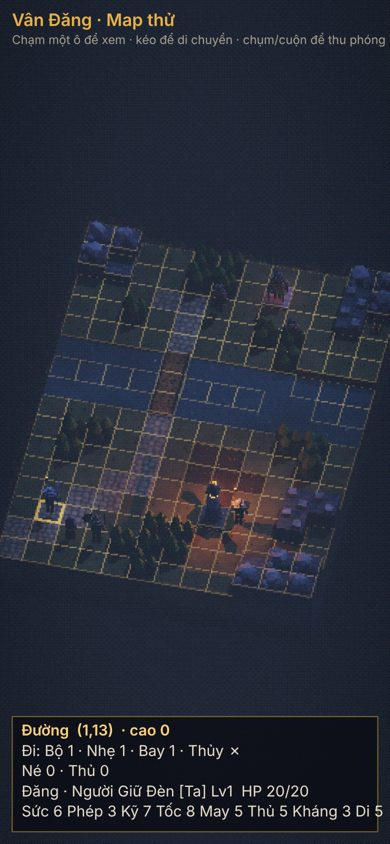

# Vân Đăng

Nhập vai chiến thuật theo lượt, 3D isometric, chạy trong **một file HTML**, ưu tiên điện thoại màn hình dọc. Khung luật Fire Emblem GBA, thế giới dân gian Việt. Tài liệu thiết kế: `GDD_Van_Dang.md` (trong Project).

Nền kỹ thuật fork từ [Cinderwatch](https://github.com/kevintngo/cinderwatch) (MIT) của Kevin Ngo; three.js r170 (MIT).



## Trạng thái: Tuần 1 (khung chạy được)

- Đã gỡ logic tower defense (`60-towers`, `61-monsters`, `62-game`).
- Dữ liệu dạng JSON trong `data/`, được nhúng vào bản build.
- Logic lõi `src/34-core.js` tách khỏi phần vẽ, có test chạy bằng Node.
- Map thử 12×16 hiển thị bằng đồ họa Cinderwatch: địa hình, độ cao, tháp đèn, miếu, cầu, quân ta/địch/NPC, rương. Chạm/nhấn một ô để xem thông số.
- Tuần 2: tìm đường (`Core.reachable/pathTo/canStopAt`); chạm quân ta để tô vùng đi, chạm ô đích để xem đường, chạm lần nữa để đi; chạm ngoài vùng để hủy. Đi xong chọn **Chờ** hoặc **Hoàn tác**; nút **Hết lượt**; vòng lượt Ta → Địch → NPC (máy tạm thời chỉ tiến về quân ta gần nhất). Bàn phím: mũi tên + Enter, Esc hủy/hoàn tác, E hết lượt.

## Chạy, build, test

```bash
python3 tools/build.py      # nối data/*.json + src/*.js + three.js -> index.html
node tools/test_core.js     # test logic lõi, không cần trình duyệt
node tools/test_combat.js   # test công thức chiến đấu (2RN, dự báo, trận đấu)
```

Mở `index.html` (chạy được từ `file://`). Cờ URL: `#map=thu`, `#biome=fen`, `#sel=4,5` (chọn sẵn ô), `#seed=N`, `#fps=1`, `#manual=1`.

Chụp màn hình không giao diện (cần Chrome, Node ≥ 22):

```bash
CHROME=/usr/bin/google-chrome MOBILE=1 DPR=2 node tools/cdp.js "sel=1,13" 390,844 wait:5000 shot:phone
CHROME=/usr/bin/google-chrome node tools/cdp.js "" 390,844 "tapat:__vd.screenOfTile(7,12).join(',')" "eval:JSON.stringify(__vd.G.sel)"
```

## Cấu trúc

| Đường dẫn | Nội dung |
| --- | --- |
| `data/terrain.json` | Bảng địa hình (GDD 3.1): chi phí đi theo loại quân, Né, Thủ |
| `data/units.json` | Mẫu đơn vị: chỉ số (GDD 2.2), nhãn, loại di chuyển, `look` cho phần vẽ |
| `data/maps/*.json` | Map: 3 lớp ASCII + roster |
| `src/00-util` … `29-biome`, `40-fx`, `41-weather`, `50-rig`, `51-bestiary`, `70-pixelfont`, `80-audio` | Module nền giữ từ Cinderwatch |
| `src/11-shared.js` | Phần dùng chung tách từ Cinderwatch: vật liệu, `Soup.seg`, `clothPanel`, thư viện đồ vật `PROP` |
| `src/34-core.js` | **Logic lõi** (thuần dữ liệu): đọc/kiểm tra map, tạo đơn vị, tra ô, chi phí di chuyển, RNG có seed |
| `src/35-board.js` | Vẽ bàn cờ ô vuông từ trạng thái map |
| `src/36-play.js` | **Điều khiển lượt** (thuần dữ liệu): chọn quân → ô đích → đi → Chờ/Hoàn tác, `done`; vòng lượt Ta → Địch → NPC, nước đi tạm cho quân máy |
| `src/56-overlay.js` | Tô vùng đi được (xanh = dừng được, tím = chỉ đi qua) và vẽ đường đi |
| `src/55-units.js` | Vẽ đơn vị bằng rig người của Cinderwatch (tạm) |
| `src/72-hud.js` | HUD tạm (font hệ thống, có dấu tiếng Việt) |
| `src/90-main.js` | Camera (giữ từ Cinderwatch), nhập liệu, vòng lặp, khởi động |
| `legacy/` | File Cinderwatch không build nữa, giữ để tham khảo (đường đi, địa hình cong, đồ vật, UI cũ) |
| `tools/` | `build.py`, `test_core.js`, `cdp.js`, `record.js` |

Quy ước: các file `src/*.js` được nối theo thứ tự tên vào một hàm; `34-core.js` và `36-play.js` không được dùng THREE/DOM để còn chạy trong Node.

## Định dạng map (`data/maps/<id>.json`)

```json
{
  "id": "thu", "name": "Map thử", "biome": "ashen",
  "terrain": ["MM..FF....MM", "..."],
  "height":  ["220000000022", "..."],
  "units":   ["............", ".......E....", "..."],
  "roster":  { "A": ["dang", "linh", "tran"], "E": ["vien_giao", "vien_kiem", "vien_kiem"], "N": ["dan_lang"], "C": ["thuoc_nho"] }
}
```

- Mỗi lớp là mảng dòng, dòng 0 là phía Bắc. Các lớp phải cùng kích thước; tối đa 16×20, chuẩn 12×16.
- `terrain`: `.` đồng · `=` đường · `F` rừng · `M` núi · `~` nước nông · `W` nước sâu · `B` cầu · `S` đầm lầy · `T` tháp đèn · `P` miếu · `#` vách · `^` dốc.
- `height`: chữ số 0–3.
- `units`: `A` ta · `E` địch · `N` NPC · `C` rương · `.` trống.
- `roster`: gán mẫu (khóa trong `data/units.json`) cho từng ký hiệu **theo thứ tự đọc** trái→phải, trên→dưới. Với `C` là mã vật phẩm trong rương.
- `biome`: bảng màu/ánh sáng Cinderwatch (`ashen`, `frost`, `fen`, `ember`, `dunes`).

`Core.validateMap` báo lỗi rõ ràng khi sai kích thước, ký hiệu lạ, độ cao ngoài 0–3, roster lệch số lượng, mẫu không tồn tại, hoặc quân đứng trên ô không đi được.

## Ghi công

- Cinderwatch © Kevin Ngo, MIT ([LICENSE](LICENSE)).
- three.js, MIT ([notice](vendor/LICENSE-three.txt)).
